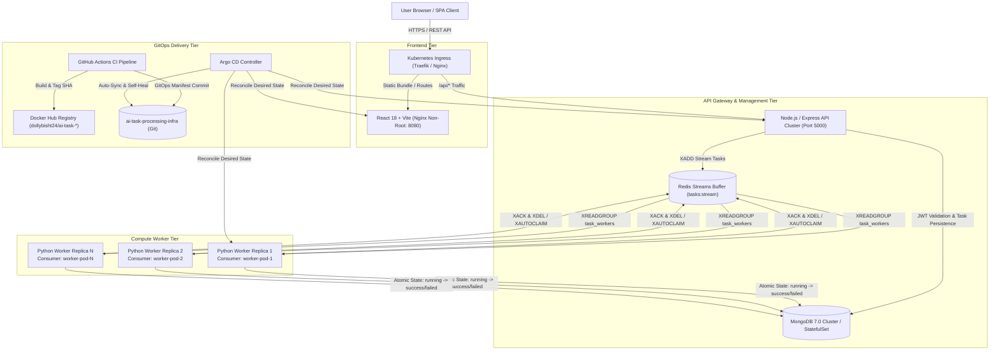
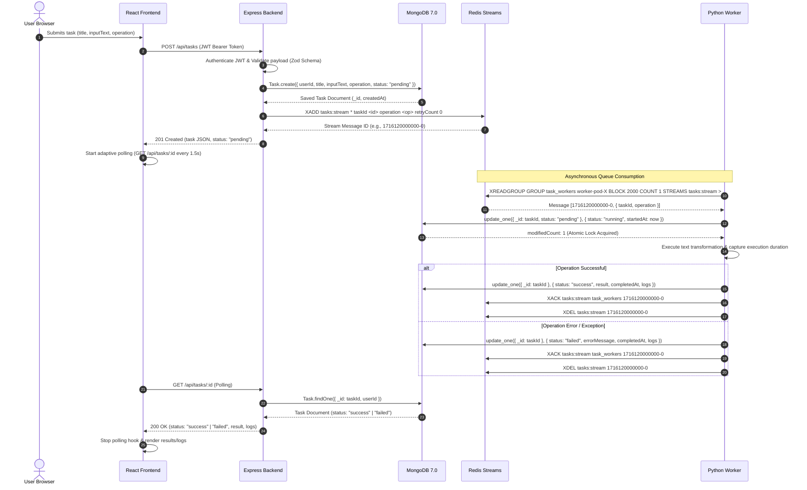
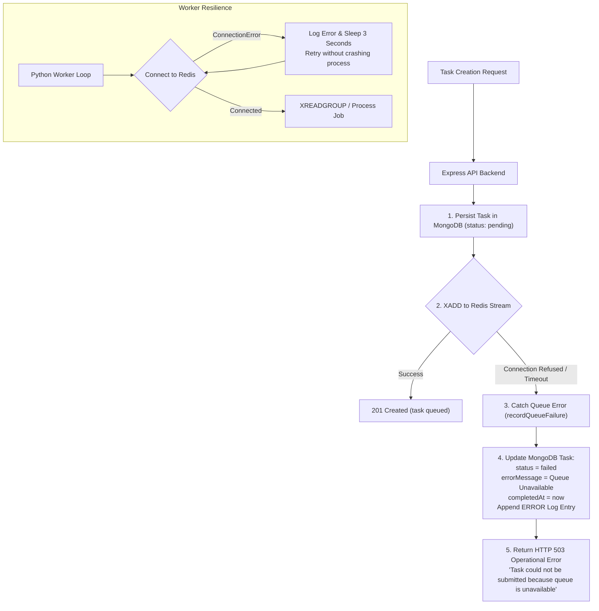
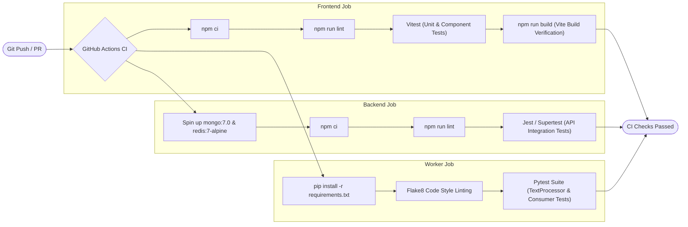
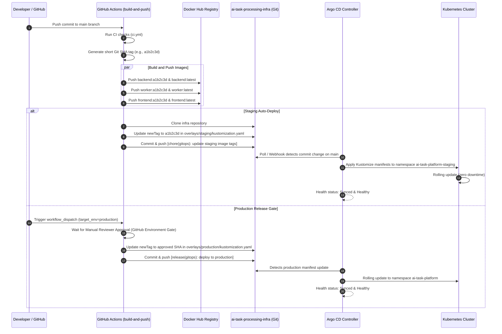

# AI Task Processing Platform — System Architecture & Engineering Whitepaper

An enterprise-grade, asynchronous, distributed text processing platform built on Node.js, Express, Redis Streams, Python 3.12, MongoDB, React, Docker, Kubernetes, and Argo CD GitOps.

---

## 1. System Architecture Overview

### Architectural Philosophy
The **AI Task Processing Platform** is engineered to separate request orchestration from computational processing. In traditional synchronous web architectures, executing long-running computational workloads (such as algorithmic text manipulation, large payload transformation, or AI model inference) directly within the HTTP request-response cycle leads to severe thread starvation, HTTP gateway timeouts (e.g., 504 Gateway Timeout), unconstrained memory spikes, and degraded user experience.

This platform resolves these challenges by implementing an **asynchronous, event-driven, distributed architecture**. The web-facing API tier handles authentication, input validation, and job scheduling in milliseconds, delegating all computational execution to an independently scalable worker tier through an in-memory queue.



### Component Breakdown and Responsibilities

1. **Frontend Tier (React 18 + Vite + Tailwind CSS + Lucide Icons)**:
   - **Role**: Presents an enterprise dashboard offering user authentication, task submission, real-time status monitoring, detailed log inspection, and aggregate telemetry.
   - **Communication**: Communicates exclusively with the Backend API over HTTP REST endpoints (`/api/*`). Uses Axios with credentials support, Bearer token injection, and an adaptive polling hook (`useTaskPolling`) that checks execution status every 1.5 seconds while tasks are in `pending` or `running` state and terminates polling upon reaching a terminal state (`success` or `failed`).
   - **Runtime**: Packaged into an ultra-lightweight container using multi-stage Docker builds and served through `nginxinc/nginx-unprivileged:1.27-alpine` running as non-root user `nginx` (UID 101) on port 8080.

2. **Backend API Tier (Node.js 20 + Express 4 + Mongoose 8 + ioredis 5)**:
   - **Role**: Acts as the stateless API gateway and control plane. Manages user registration/login, issues and verifies JWT tokens, validates task input via Zod schemas, enforces per-user resource isolation, persists metadata to MongoDB, and publishes jobs to Redis Streams.
   - **Security & Reliability**: Hardened with Helmet HTTP security headers, CORS origin enforcement, and `express-rate-limit` (10,000 requests per 15 minutes globally; 100 requests per 15 minutes on authentication endpoints). Exposes unthrottled health probes at `/api/health` and `/api/ready`.
   - **Runtime**: Runs on `node:20-alpine` under non-root built-in user `node` (UID 1000) using `dumb-init` as PID 1.

3. **Message Queue Tier (Redis 7.0 Streams)**:
   - **Role**: Provides a high-throughput, persistent in-memory streaming buffer between the API tier and the background workers using the stream key `tasks:stream` and consumer group `task_workers`.
   - **Guarantees**: Unlike ephemeral Redis Pub/Sub, Redis Streams persists messages to disk via Append-Only File (AOF) with `fsync everysec`, tracks message assignment in a Pending Entries List (PEL), supports explicit consumer acknowledgment (`XACK`), and enables orphaned job reclamation (`XAUTOCLAIM`).

4. **Compute Worker Tier (Python 3.12 + PyMongo + redis-py)**:
   - **Role**: Dedicated asynchronous background processor executing CPU-bound text processing operations (`UPPERCASE`, `LOWERCASE`, `REVERSE_STRING`, `WORD_COUNT`).
   - **Execution Flow**: Continuously pulls messages using `XREADGROUP`, performs atomic state transitions in MongoDB (`pending` $\rightarrow$ `running`), executes the deterministic operation, captures microsecond execution duration, records structured log entries, updates the terminal state (`success` or `failed`), and cleanly acknowledges (`XACK`) and deletes (`XDEL`) the stream entry.
   - **Runtime**: Multi-stage build on `python:3.12-slim`, running under dedicated non-root user `workeruser` (UID 10001, GID 10001).

5. **Persistence Tier (MongoDB 7.0)**:
   - **Role**: Authoritative persistent system of record storing user credentials, task definitions, execution results, structured task logs, error messages, and lifecycle timestamps (`createdAt`, `startedAt`, `completedAt`).
   - **Indexing**: Utilizes compound indexes designed for the Equality-Sort-Range (ESR) rule to eliminate in-memory sorting and support rapid pagination and user statistics aggregation.

6. **GitOps & Delivery Tier (GitHub Actions + Argo CD)**:
   - **Role**: Automates testing, container image publishing, and declarative continuous delivery across staging and production environments using a two-repository architecture (`ai-task-processing-platform` and `ai-task-processing-infra`).

---

### End-to-End Task Lifecycle

The following sequence details the lifecycle of a task from client submission to terminal state resolution:



#### Detailed Lifecycle Steps:
1. **Submission**: Authenticated user submits task parameters via the React UI (`title`, `inputText`, `operation`).
2. **Validation & Authorization**: Express middleware verifies the JWT token from the `Authorization: Bearer <token>` header or HttpOnly cookie, establishes `req.user`, and validates the request body using Zod (`title`: max 200 chars, `inputText`: max 50,000 chars, `operation`: enum validation).
3. **Database Insertion**: Backend creates a MongoDB task document with initial status `pending` and an initial log entry (`Task initialized with operation...`).
4. **Queue Enqueue**: Backend executes `XADD tasks:stream * taskId <id> operation <operation> retryCount 0 enqueuedAt <iso>`. If Redis is temporarily unreachable, the backend updates the task status in MongoDB to `failed`, logs the queue error, and returns an HTTP 503 Operational Error to the client.
5. **Worker Pickup**: A Python worker replica listening on consumer group `task_workers` reads the job using `XREADGROUP ... STREAMS tasks:stream >`. The `>` character ensures the message is delivered exclusively to this worker.
6. **Atomic State Transition**: Worker executes an atomic conditional update:
   ```python
   db.tasks.update_one(
       {"_id": ObjectId(task_id), "status": "pending"},
       {"$set": {"status": "running", "startedAt": now, "updatedAt": now}, "$push": {"logs": log_entry}}
   )
   ```
   If `modified_count == 0` (e.g., job was already picked up or canceled), the worker aborts execution to prevent duplicate processing.
7. **Execution**: The worker invokes `TextProcessor.process(operation, inputText)`. High-resolution timing (`time.perf_counter()`) tracks processing duration.
8. **Result Persistence**: Upon successful execution, the worker writes the calculated result, duration, and structured logs to MongoDB and sets status to `success`. If an unexpected error occurs, it sets status to `failed` and records the error stack.
9. **Stream Cleanup**: The worker issues `XACK tasks:stream task_workers <message_id>` followed by `XDEL tasks:stream <message_id>`. This removes the entry from the Pending Entries List (PEL) and frees memory in Redis.
10. **Client Notification**: The frontend's polling cycle receives the updated task status, displays a success/failure toast, and renders output results and execution logs.

---

## 2. Worker Scaling Strategy & Distributed Queueing

### Horizontal Scaling Architecture
The compute worker tier is designed for linear horizontal scalability. Because Python worker pods are completely stateless and maintain no in-memory session affinity, compute capacity can be scaled up or down on demand by adjusting Kubernetes deployment replicas without modifying application code.

Each worker pod is injected with a unique worker identifier derived from its Kubernetes Pod metadata:
```yaml
env:
  - name: POD_NAME
    valueFrom:
      fieldRef:
        fieldPath: metadata.name
  - name: WORKER_ID
    value: "worker-$(POD_NAME)"
```

### Redis Streams Consumer Group Mechanics
Unlike standard Redis Lists (which pop items destructively via `BLPOP`) or Redis Pub/Sub (which broadcasts ephemerally to all listeners with zero persistence), Redis Streams provides distributed streaming with explicit partition management:

| Dimension | Redis Pub/Sub | Redis Lists (`BLPOP`) | Redis Streams (`XREADGROUP`) |
| :--- | :--- | :--- | :--- |
| **Delivery Model** | Ephemeral broadcast (at-most-once) | Point-to-point competing pop | Partitioned Consumer Groups (at-least-once) |
| **Data Persistence** | None (dropped if worker offline) | In-memory queue until popped | Append-Only Log on disk (AOF + RDB) |
| **Message Acknowledgment** | Not supported | Not supported (lost on crash) | Explicit `XACK` required |
| **Crash Recovery** | Zero recovery | Manual compensation required | Built-in Pending Entries List (PEL) |
| **Message Reclamation** | Not possible | Not possible | Automated via `XAUTOCLAIM` |

#### Consumer Group Processing Flow:
1. **Partitioning**: All worker pods register under the single consumer group `task_workers`. When pod `worker-79b8c69b85-x4z2l` invokes `XREADGROUP GROUP task_workers worker-79b8c69b85-x4z2l BLOCK 2000 COUNT 1 STREAMS tasks:stream >`, Redis assigns the next unprocessed message exclusively to that pod.
2. **Pending Entries List (PEL)**: Redis moves the delivered message into the consumer group's PEL, recording the message ID, consumer name, idle time, and delivery count.
3. **Acknowledgment & Deletion**: Only after the worker successfully persists the result into MongoDB does it issue `XACK` followed by `XDEL`.
4. **Crash Recovery (`XAUTOCLAIM`)**: If a worker crashes mid-task (due to an out-of-memory kill, Kubernetes node preemption, or network partition), the message remains pending in the PEL. Surviving worker replicas run an automated background check every 15 seconds:
   ```python
   result = redis_client.xautoclaim(
       name="tasks:stream",
       groupname="task_workers",
       consumername=self.worker_id,
       min_idle_time=30000, # 30 seconds idle threshold
       start_id="0-0",
       count=5
   )
   ```
   Any message idle in the PEL for longer than 30 seconds (`CLAIM_MIN_IDLE_TIME_MS`) is automatically reassigned to an active worker for reprocessing.

### Kubernetes Deployment and HPA Configuration

#### Verified Manifest Configuration:
- **Base Deployment (`ai-task-processing-infra/kubernetes/base/worker/deployment.yaml`)**:
  - `replicas`: 2
  - `resources.requests`: `cpu: 100m`, `memory: 128Mi`
  - `resources.limits`: `cpu: 500m`, `memory: 512Mi`
- **Staging Overlay (`kubernetes/overlays/staging/kustomization.yaml`)**:
  - `replicas`: Patched to 1 (cost/resource optimization for test environments).
- **Production Overlay (`kubernetes/overlays/production/kustomization.yaml` & `hpa.yaml`)**:
  - Initial `replicas`: Patched to 4.
  - **HorizontalPodAutoscaler (`worker-hpa`)**:
    ```yaml
    apiVersion: autoscaling/v2
    kind: HorizontalPodAutoscaler
    metadata:
      name: worker-hpa
      namespace: ai-task-platform
    spec:
      scaleTargetRef:
        apiVersion: apps/v1
        kind: Deployment
        name: worker
      minReplicas: 3
      maxReplicas: 15
      metrics:
        - type: Resource
          resource:
            name: cpu
            target:
              type: Utilization
              averageUtilization: 70
    ```

### Monitoring Metrics and Scaling Triggers

To maintain optimal worker throughput and detect bottlenecks, the following metrics should be tracked:
1. **Queue Length**: Measured via `XLEN tasks:stream`. Indicates unprocessed tasks waiting in the queue.
2. **Pending Entries List (PEL) Depth**: Measured via `XPENDING tasks:stream task_workers`. Indicates messages currently being processed or stalled.
3. **Oldest Pending Message Age**: Tracks lag in the PEL; values $> 30\text{ seconds}$ indicate worker stalls.
4. **Worker CPU/Memory Utilization**: Measured via Kubernetes Metrics Server / cAdvisor (`kubectl top pods`).
5. **Task Execution Duration**: Logged by worker in milliseconds (`duration_ms`).
6. **Task Failure Rate**: Monitored via MongoDB status aggregation (`failed / total`).

#### Scaling Triggers:
- **Scale Out (Increase Replicas)**: Triggered when average worker CPU utilization exceeds 70%, or when stream length (`XLEN`) grows continuously over a 2-minute window.
- **Scale In (Decrease Replicas)**: Triggered when CPU utilization drops below 40% and queue length remains at 0 for $> 5\text{ minutes}$.

### Duplicate Processing Prevention and Crash Handling

1. **Idempotency Check**: When consuming a message, the worker inspects the MongoDB task document:
   ```python
   if task.get("status") == "success":
       logger.info(f"Task [{task_id}] already completed. Skipping.")
       self.acknowledge_message(message_id)
       return
   ```
2. **Atomic Status Locking**: The worker uses `update_one({"_id": oid, "status": "pending"}, ...)` to acquire execution rights. If another worker reclaimed the job concurrently, only one update succeeds.
3. **Graceful Shutdown**: The worker registers `SIGINT` and `SIGTERM` signal handlers. Upon receiving a termination signal from Kubernetes, it ceases polling, finishes the in-flight task, closes database connections cleanly, and exits.

### Scaling Strategy: Current Implementation vs. Proposed Improvements

| Feature | Current Implementation | Proposed Production Improvement |
| :--- | :--- | :--- |
| **Scaling Metric** | Resource-based (CPU utilization $\ge 70\%$) via Kubernetes HPA | Queue-depth-based via **KEDA** (Kubernetes Event-driven Autoscaling) targeting Redis Stream lag |
| **Min / Max Replicas** | Staging: 1 replica fixed; Production: 3 to 15 replicas via HPA | Dynamic: 2 to 30 replicas with scale-to-zero support during off-peak periods |
| **Task Reclamation** | Worker-side `XAUTOCLAIM` polling every 15s (`min_idle_time: 30s`) | Dedicated supervisory sidecar or CronJob for PEL audit and alerting |
| **Worker Concurrency** | Single-threaded polling loop (`count=1`) per container | Multi-threaded / AsyncIO worker concurrency handling multiple concurrent stream tasks per pod |

---

## 3. Handling High Task Volume (100,000 Tasks Per Day)

### Workload Mathematical Modeling

A production platform processing **100,000 tasks per day** requires clear separation between average throughput and peak burst traffic:

#### 1. Daily Average Throughput
$$\text{Seconds per day} = 24 \times 60 \times 60 = 86,400\text{ seconds}$$
$$\text{Throughput}_{\text{avg}} = \frac{100,000\text{ tasks}}{86,400\text{ seconds}} \approx 1.157\text{ tasks/second} \approx 1.16\text{ tasks/second}$$

#### 2. Business-Hours Peak Distribution
Real-world enterprise traffic is rarely uniform. In typical SaaS applications, approximately 70% of total daily volume arrives during an 8-hour business window (e.g., 9:00 AM to 5:00 PM):
$$\text{Tasks during peak window} = 0.70 \times 100,000 = 70,000\text{ tasks}$$
$$\text{Peak window duration} = 8 \times 3,600 = 28,800\text{ seconds}$$
$$\text{Throughput}_{\text{peak}} = \frac{70,000\text{ tasks}}{28,800\text{ seconds}} \approx 2.43\text{ tasks/second}$$

#### 3. Extreme Burst Spikes (10x Factor)
During marketing events, batch client submissions, or morning login peaks, arrival rates can spike to **5x–10x** the peak average for intervals lasting 1 to 15 minutes:
$$\text{Throughput}_{\text{burst}} = 10 \times \text{Throughput}_{\text{peak}} \approx 24.3\text{ tasks/second} \approx 25\text{ tasks/second}$$

---

### Asynchronous Buffering and Shock Absorption

In a synchronous architecture, a burst of 25 concurrent requests per second would saturate backend HTTP connections, deplete thread pools, and cause cascading request drops. 

Under the AI Task Processing Platform architecture:
1. **Stateless API Ingestion**: The Node.js Express backend only performs lightweight JWT validation, a single MongoDB `INSERT`, and a Redis `XADD`. Benchmarks on Node.js/Express demonstrate response latencies under 15ms for this path.
2. **Buffer Absorption**: Redis Streams comfortably handles over 50,000 `XADD` operations per second on a single core. The arrival burst is absorbed entirely in memory without rejecting client requests.
3. **Decoupled Execution**: Workers continue processing tasks at a sustainable, steady-state rate. During bursts, the queue length (`XLEN`) increases temporarily, acting as an elastic shock absorber.

```
Incoming Request Spike (25 tasks/sec)
           │
           ▼
┌───────────────────────────────┐
│ Express API Cluster (Node.js) │ (Intake rate: 25 tasks/sec, ~15ms response)
└──────────────┬────────────────┘
               │ XADD
               ▼
┌───────────────────────────────┐
│  Redis Stream (tasks:stream)  │ ◄── Buffer absorbs burst (Queue length grows)
└──────────────┬────────────────┘
               │ XREADGROUP
               ▼
┌───────────────────────────────┐
│ Python Worker Pool (HPA: 3-15)│ (Drain rate: 4 workers * 8 tasks/sec = 32 tasks/sec)
└───────────────────────────────┘
```

---

### Database Connection Pooling and Write Capacity

Processing 100,000 tasks/day generates a predictable database write load:
- $1\times \text{Insert}$ on creation (`pending`)
- $1\times \text{Update}$ on worker pickup (`running`)
- $1\times \text{Update}$ on completion (`success` / `failed`)
- **Total writes per day**: $300,000\text{ operations/day}$
- **Average write rate**: $300,000 / 86,400 \approx 3.47\text{ writes/second}$
- **Peak write rate (70% in 8 hrs)**: $(3 \times 70,000) / 28,800 \approx 7.29\text{ writes/second}$
- **Burst write rate (10x)**: $\approx 73\text{ writes/second}$

Standard MongoDB standalone instances on modern SSDs comfortably sustain 2,000 to 10,000 writes/second. The calculated write rate of 73 writes/second during peak bursts consumes $< 5\%$ of MongoDB's I/O capacity.

#### Connection Pooling Configuration:
- **Backend (Mongoose)**: Defaults to a connection pool size of 100 sockets per pod. With 2 to 3 backend replicas in production, up to 300 concurrent database sockets are available.
- **Worker (PyMongo)**: Explicitly configured with `maxPoolSize=50` and `minPoolSize=10` per worker pod (`ai-task-processing-platform/worker/app/database/mongo_client.py`). Across 4 worker replicas, the worker pool maintains up to 200 concurrent MongoDB sockets.

---

### Database Query Optimization & Pagination
To ensure high read performance when querying task history under high volume:
1. **Lean Queries**: Backend uses Mongoose `.lean()` on `getUserTasks`, bypassing Mongoose document hydration and reducing memory allocation by $\approx 70\%$.
2. **Selective Projections**: Endpoints fetch only required fields (e.g., `getTaskLogs` selects only `logs title status`).
3. **Compound Index Coverage**: Queries filter on `userId` and sort on `createdAt` in descending order, utilizing the compound index `{ userId: 1, createdAt: -1 }` to eliminate in-memory sorting.
4. **Pagination**: Implemented via `page` and `limit` (default: 10, max: 100) to cap memory footprint per query.

---

### Practical Capacity-Planning Framework

| Tier | Component | Sizing for 100k Tasks/Day | Bottleneck Indicator |
| :--- | :--- | :--- | :--- |
| **Ingress / Network** | Traefik / Nginx Ingress | 2 replicas, 200m CPU, 256Mi RAM | 502/504 errors, high request latency |
| **API Backend** | Node.js Express Cluster | 3 replicas (HPA 2–10), 100m–500m CPU, 128Mi–512Mi RAM | Event loop lag $> 50\text{ms}$, HTTP 429 / 503 |
| **Queue** | Redis 7.0 StatefulSet | 1 instance (Production: Sentinel HA), 500m CPU, 1Gi RAM | Memory usage $> 80\%$, command latency |
| **Compute Workers** | Python Worker Cluster | 4 to 8 replicas (HPA 3–15), 100m–500m CPU, 128Mi–512Mi RAM | Stream PEL age $> 30\text{s}$, queue growth |
| **Database** | MongoDB 7.0 StatefulSet | 1 instance (Production: 3-node Replica Set), 1000m CPU, 2Gi RAM | WiredTiger cache eviction, slow queries $> 100\text{ms}$ |

> [!IMPORTANT]
> **Load Testing & Capacity Disclaimer**:  
> The figures and calculations presented above represent architectural capacity-planning models and traffic arrival projections. **The current local development cluster has not been benchmarked or stress-tested for 100,000 tasks per day.** Production readiness must be validated prior to enterprise deployment through systematic load testing using distributed tools such as **k6**, **Locust**, or **JMeter**, measuring p95 and p99 latencies under simulated burst and endurance conditions.

---

## 4. Database Indexing Strategy

### Actual Task and User Schema Inspection
Reviewing the codebase models (`backend/src/models/Task.js` and `backend/src/models/User.js`) establishes the exact database indexes defined in the platform.

#### Ground Truth: Defined Indexes

```javascript
// From backend/src/models/Task.js:
taskSchema.index({ userId: 1, createdAt: -1 });  // Index 1
taskSchema.index({ status: 1, createdAt: -1 });  // Index 2
taskSchema.index({ userId: 1, status: 1 });     // Index 3

// From backend/src/models/User.js:
email: { type: String, unique: true, lowercase: true } // Unique Index on email
```

| Collection | Index Key Specification | Index Type | Status | Supported Queries & Operational Rationale |
| :--- | :--- | :--- | :--- | :--- |
| `tasks` | `{ _id: 1 }` | Single Field (PK) | **Implemented** | Default unique primary key index. Powers `getTaskById`, `retryTask`, and worker status updates. |
| `tasks` | `{ userId: 1, createdAt: -1 }` | Compound | **Implemented** | Powers primary user task history queries: `Task.find({ userId }).sort({ createdAt: -1 }).skip().limit()`. |
| `tasks` | `{ status: 1, createdAt: -1 }` | Compound | **Implemented** | Supports administrative status filtering, queue monitoring, and operational dashboards tracking tasks by state. |
| `tasks` | `{ userId: 1, status: 1 }` | Compound | **Implemented** | Powers user dashboard telemetry aggregation: `Task.aggregate([ { $match: { userId } }, { $group: { _id: "$status", count: { $sum: 1 } } } ])`. |
| `users` | `{ _id: 1 }` | Single Field (PK) | **Implemented** | Default unique primary key index. Powers JWT user resolution in auth middleware. |
| `users` | `{ email: 1 }` | Single Field (Unique) | **Implemented** | Enforces email uniqueness; provides $O(1)$ lookup for login (`findOne({ email })`) and registration checks. |

---

### The Equality, Sort, Range (ESR) Indexing Rule

In MongoDB indexing design, compound indexes must adhere to the **ESR rule**:
1. **Equality (`E`)**: Fields evaluated with exact matching must appear first in the compound index.
2. **Sort (`S`)**: Fields determining sort order must appear next to allow the query planner to traverse index leaves in order without in-memory sorting.
3. **Range (`R`)**: Fields evaluated with range operators (`$gt`, `$lt`, `$in`, `$regex`) must appear last.

#### Analysis of Platform Compound Indexes:

1. **`{ userId: 1, createdAt: -1 }`**:
   - Query: `db.tasks.find({ userId: ObjectId("...") }).sort({ createdAt: -1 })`
   - **E**: `userId` is an exact match.
   - **S**: `createdAt: -1` matches the sort order.
   - **Result**: The query engine scans the index keys for the user and reads them in pre-sorted reverse chronological order. Execution stage is `IXSCAN` $\rightarrow$ `FETCH`. The blocking memory sort stage (`SORT_KEY_GENERATOR` / `SORT`) is completely eliminated.

2. **`{ userId: 1, status: 1 }`**:
   - Query: `db.tasks.aggregate([ { $match: { userId: ObjectId("...") } }, { $group: { _id: "$status", count: { $sum: 1 } } } ])`
   - **E**: `userId` is an exact match.
   - **Covered Query Support**: Both the filter (`userId`) and the grouping key (`status`) reside within the index itself. This enables index-covered scanning where the query planner never accesses raw document storage on disk.

---

### Index Performance Verification via `explain("executionStats")`

To verify that an index is operating effectively and avoiding full collection scans (`COLLSCAN`), query execution plans should be evaluated using MongoDB's `explain("executionStats")`:

```javascript
// Query plan inspection in mongosh:
db.tasks.find({ 
  userId: ObjectId("6650a1b2c3d4e5f6a7b8c9d0") 
}).sort({ createdAt: -1 }).limit(10).explain("executionStats");
```

#### Key Execution Metrics:
- **`stage`**: Must report `IXSCAN` (Index Scan). A `COLLSCAN` indicates a missing index.
- **`totalDocsExamined` vs. `nReturned`**: In an ideal index-covered pagination query, the ratio is $1:1$ (e.g., examining 10 documents to return 10 documents). If `totalDocsExamined` is significantly higher than `nReturned`, the index selectivity is suboptimal.
- **`totalKeysExamined`**: Number of index entries scanned.
- **`executionStages.stage`**: Ensure there is no `SORT` stage. The presence of `SORT` indicates an in-memory sort which fails if sort memory exceeds 32MB.

---

### Write-Performance Trade-offs

Every additional index incurs overhead on write operations:
- On `Task.create()`: The primary index and all 3 compound indexes must be updated (4 B-tree modifications).
- On worker status update: When `status` transitions from `pending` $\rightarrow$ `running` $\rightarrow$ `success`, indexes containing `status` (`{ status: 1, createdAt: -1 }` and `{ userId: 1, status: 1 }`) must rebalance their B-tree leaf nodes.
- **Architectural Decision**: The current schema maintains 3 targeted compound indexes. This represents an optimal balance: it provides complete coverage for user task history, status filtering, and dashboard telemetry without overburdening write throughput.

---

### Indexing Roadmap: Implemented vs. Recommended Improvements

| Index Specification | Target Collection | Type | Status | Technical Justification |
| :--- | :--- | :--- | :--- | :--- |
| `{ userId: 1, createdAt: -1 }` | `tasks` | Compound | **Implemented** | Primary task history query index. |
| `{ status: 1, createdAt: -1 }` | `tasks` | Compound | **Implemented** | Status filtering index. |
| `{ userId: 1, status: 1 }` | `tasks` | Compound | **Implemented** | User dashboard stats aggregation index. |
| `{ status: 1, createdAt: 1 }` with `partialFilterExpression: { status: "pending" }` | `tasks` | Partial Compound | **Recommended Improvement** | Optimizes queue triage queries by indexing only active `pending` tasks (~0.1% of collection), minimizing index size and write overhead. |
| `{ userId: 1, title: "text" }` | `tasks` | Text / Search | **Recommended Improvement** | Replaces unindexed regex search (`$regex: search`) with full-text search, avoiding regex collection scans. |
| `{ createdAt: 1 }` with `expireAfterSeconds: 2592000` | `tasks` | TTL Index | **Recommended Improvement** | Automatically purges completed task logs older than 30 days to bound storage growth. |

---

## 5. Handling Redis Failure & Resilience Architecture

### Failure Modes and System Behavior

Redis serves as the high-throughput asynchronous communication buffer. If Redis becomes temporarily unreachable (e.g., node restart, network partition, memory exhaustion), the platform maintains resilience through defensive programming:



---

### Implemented Failure Handling Mechanisms

1. **Backend Queue Failure Isolation (`recordQueueFailure`)**:
   - Located in `ai-task-processing-platform/backend/src/services/taskService.js`.
   - When `queueService.enqueueTask()` throws an error (e.g., Redis offline):
     - The task record already persisted in MongoDB is immediately updated: `status = "failed"`, `errorMessage = "Failed to enqueue task in Redis queue: ..."`.
     - An explicit structured log entry with level `ERROR` is appended to `task.logs`.
     - The error is wrapped with `statusCode = 503` and returned to the client:
       ```json
       {
         "success": false,
         "message": "Task could not be submitted because the queue is unavailable."
       }
       ```
     - **Guarantee**: Tasks are never lost in an unrecorded state; the client receives clear operational feedback, and MongoDB reflects the actual failure state.

2. **Backend Automatic Reconnection Strategy**:
   - `ioredis` is configured with exponential backoff:
     ```javascript
     retryStrategy(times) {
       const delay = Math.min(times * 200, 3000);
       logger.warn(`Redis reconnecting attempt ${times} after ${delay}ms...`);
       return delay;
     }
     ```
   - Retries up to 3 times per request (`maxRetriesPerRequest: 3`) before failing fast.

3. **Worker Reconnection and Fault Tolerance**:
   - The Python worker consumer loop wraps Redis interactions in a resilient `try/except` block:
     ```python
     except redis.ConnectionError as ce:
         logger.error(f"Redis connection lost: {str(ce)}. Reconnecting in 3 seconds...")
         self.redis_client = None
         time.sleep(3)
     ```
   - The worker never exits or crashes due to Redis unavailability; it enters a backoff retry state and automatically resumes stream consumption the moment Redis recovers.

4. **Redis Persistence Configuration**:
   - The platform configures Redis with Append-Only File (AOF) persistence:
     - `appendonly yes`
     - `appendfsync everysec`
   - In the event of an unexpected Redis container restart, queue entries and consumer group metadata are restored from disk with a maximum data-loss window of 1 second.

5. **Poison Pill Mitigation**:
   - If a corrupted or malformed task payload arrives (e.g., missing fields, unparseable input):
     - The worker catches the error, marks the task as `failed` in MongoDB with the exact exception details, and immediately calls `XACK` and `XDEL`.
     - This acknowledges the bad message and prevents it from infinitely blocking the worker or triggering an unhandled crash loop.

---

### Resilience Architecture: Implemented vs. Proposed Improvements

| Resilience Feature | Current Implementation | Proposed Production Improvement |
| :--- | :--- | :--- |
| **Redis Topology** | Single StatefulSet replica with PersistentVolumeClaim | **Redis Sentinel** (1 primary, 2 replicas, 3 sentinels) or **Redis Cluster** for automated sub-second failover |
| **Publishing Fallback** | Marks MongoDB task as `failed` and returns HTTP 503 | **Outbox Pattern**: If Redis is offline, persist task with `status: pending_queue`; background dispatcher flushes to Redis upon reconnection |
| **Dead-Letter Queue (DLQ)** | Poison pills marked `failed` in MongoDB and acknowledged | Dedicated stream `tasks:dead_letter` where jobs exceeding 3 retries are diverted for developer inspection |
| **Redis Memory Policy** | Default `noeviction` | Explicit `maxmemory` cap with `volatile-lru` or alerting when memory exceeds 80% threshold |

---

## 6. Staging and Production Deployment Strategy via GitOps

### Dual-Repository GitOps Architecture

The platform strictly separates application source code from deployment infrastructure across two independent Git repositories:
1. **Application Repository (`ai-task-processing-platform`)**: Contains source code for frontend, backend, worker, test suites, and Dockerfiles.
2. **Infrastructure Repository (`ai-task-processing-infra`)**: Contains canonical Kubernetes blueprints (Kustomize `base`), environment overlays (`staging` and `production`), Argo CD declarative Application manifests, and cluster bootstrap scripts.

```
ai-task-processing-infra/
├── kubernetes/
│   ├── base/                       # Shared resource definitions
│   │   ├── backend/                # Deployment, Service
│   │   ├── frontend/               # Deployment, Service
│   │   ├── worker/                 # Deployment
│   │   ├── mongodb/                # StatefulSet, Service, PVC
│   │   ├── redis/                  # StatefulSet, Service, PVC
│   │   ├── ingress.yaml            # Base Traefik Ingress
│   │   ├── configmap.yaml          # Shared configuration
│   │   └── kustomization.yaml
│   └── overlays/
│       ├── staging/                # Staging environment overlay
│       │   ├── namespace.yaml      # ai-task-platform-staging
│       │   ├── configmap.yaml      # Staging environment overrides
│       │   ├── ingress.yaml        # Host: staging.ai-task.local
│       │   └── kustomization.yaml  # Replicas = 1, staging tags
│       └── production/             # Production environment overlay
│           ├── namespace.yaml      # ai-task-platform
│           ├── configmap.yaml      # Production environment overrides
│           ├── ingress.yaml        # Host: ai-task.local (TLS ready)
│           ├── hpa.yaml            # Backend HPA (2-10), Worker HPA (3-15)
│           └── kustomization.yaml  # Replicas = 3-4, production tags
└── argocd/
    ├── staging-application.yaml    # Argo CD Staging App Manifest
    └── production-application.yaml # Argo CD Production App Manifest
```

---

### Environment Comparison Matrix

| Property | Staging Environment (`staging`) | Production Environment (`production`) |
| :--- | :--- | :--- |
| **Kubernetes Namespace** | `ai-task-platform-staging` | `ai-task-platform` |
| **Backend Replicas** | 1 replica | 3 replicas base (Autoscaling: min 2, max 10 via HPA) |
| **Worker Replicas** | 1 replica | 4 replicas base (Autoscaling: min 3, max 15 via HPA) |
| **Frontend Replicas** | 1 replica | 3 replicas base |
| **Autoscaling (HPA)** | Disabled | Enabled (Backend: 75% CPU / 80% RAM; Worker: 70% CPU) |
| **Ingress Hostname** | `staging.ai-task.local` | `ai-task.local` |
| **Image Tagging** | Short Git Commit SHA (`staging-latest`) | Immutable SemVer / Production Git Commit SHA (`v1.0.0`) |
| **Log Level** | `DEBUG` | `INFO` |
| **Data Isolation** | Dedicated staging MongoDB PVC & Redis PVC | Dedicated production MongoDB PVC & Redis PVC |

---

### CI/CD and GitOps Delivery Pipelines

#### Continuous Integration Pipeline (`.github/workflows/ci.yml`)
Triggered on every pull request and push to `main` and `develop`:



---

#### GitOps Continuous Deployment Pipeline (`.github/workflows/build-and-push.yml` + Argo CD)



---

### Instant Rollback Strategy
If an unforeseen defect is detected in a deployed release:
1. **GitOps Rollback Principle**: Deployment state is strictly tied to Git. To roll back, an engineer reverts the manifest commit in the infrastructure repository:
   ```bash
   git revert <commit-sha>
   git push origin main
   ```
   Alternatively, the image tag in `kustomization.yaml` is updated to a previous known-good SHA.
2. **Argo CD Reconciliation**: Argo CD detects the Git change within seconds, reconciles the cluster state, and triggers a Kubernetes rolling update reverting pods to the prior image version.
3. **Zero Container Rebuilds**: Because images are immutable and tagged by commit SHA, rollbacks complete in seconds without re-running CI builds or re-packaging containers.

---

### Container Probes and Health Lifecycle

All services implement explicit Kubernetes Liveness and Readiness probes to guarantee high availability during rollouts:

```yaml
# Backend Probes (ai-task-processing-infra/kubernetes/base/backend/deployment.yaml)
livenessProbe:
  httpGet:
    path: /api/health
    port: 5000
  initialDelaySeconds: 15
  periodSeconds: 10
  timeoutSeconds: 3
  failureThreshold: 3
readinessProbe:
  httpGet:
    path: /api/ready
    port: 5000
  initialDelaySeconds: 10
  periodSeconds: 5
  timeoutSeconds: 3
  failureThreshold: 2
```

```yaml
# Worker Probes (ai-task-processing-infra/kubernetes/base/worker/deployment.yaml)
livenessProbe:
  exec:
    command:
      - python
      - -c
      - "import os,sys; sys.exit(0 if b'python' in open('/proc/1/cmdline','rb').read() else 1)"
  initialDelaySeconds: 15
  periodSeconds: 20
readinessProbe:
  exec:
    command:
      - python
      - -c
      - "from app.config.settings import settings; import redis; from app.database.mongo_client import get_mongo_client; redis.Redis(host=settings.REDIS_HOST, port=settings.REDIS_PORT, password=settings.REDIS_PASSWORD or None, socket_connect_timeout=2).ping(); get_mongo_client().admin.command('ping')"
  initialDelaySeconds: 10
  periodSeconds: 10
```

- **Readiness Probes**: Ensure that pods receive traffic only after all database and Redis network connections are established.
- **Liveness Probes**: Detect deadlocks or terminated processes and automatically trigger container restarts.

---

## 7. Security Architecture & Controls

### Implemented Security Controls

1. **Authentication & Token Security**:
   - **JWT Implementation**: Signed with HMAC SHA-256 using a high-entropy secret (`JWT_SECRET` minimum 32 characters). Tokens expire in 7 days.
   - **Dual Token Transmission**: Supports both `Authorization: Bearer <token>` headers (for API clients) and `HttpOnly`, `SameSite=Strict` cookies (for browser XSS defense).
   - **Password Security**: Passwords hashed using `bcryptjs` with salt rounds = 10. The password hash is explicitly excluded from database query projections (`select: false`) and sanitized in Mongoose `toJSON()`.

2. **Authorization & Tenant Isolation**:
   - Every task endpoint (`/api/tasks/*`) requires authenticated middleware.
   - All MongoDB queries strictly scope to `userId: req.user._id`, preventing horizontal privilege escalation or unauthorized task access.

3. **HTTP Header Hardening & Rate Limiting**:
   - **Helmet**: Injects security headers including `X-Content-Type-Options: nosniff`, `X-Frame-Options: SAMEORIGIN`, and strict Content Security Policies.
   - **Rate Limiting**: Configured using `express-rate-limit`:
     - Global API rate limit: 10,000 requests per 15 minutes.
     - Authentication rate limit: 100 requests per 15 minutes on `/api/auth/*` to prevent brute-force attacks.
     - Health endpoints (`/api/health`, `/api/ready`) are exempt to prevent probe starvation.

4. **Container Security & Least Privilege**:
   - **Non-Root Execution**:
     - Backend: Runs under built-in unprivileged user `node` (UID 1000).
     - Worker: Runs under dedicated user `workeruser` (UID 10001, GID 10001).
     - Frontend: Runs under unprivileged user `nginx` (UID 101) on port 8080.
   - **Multi-Stage Builds**: Compilers, build tools, development headers, and package caches are excluded from runtime images, minimizing attack surface and image size.

5. **Infrastructure Secret Management**:
   - Passwords, JWT secrets, and connection URIs are injected into pods using Kubernetes Secrets (`ai-task-secrets`).
   - Secret files are strictly excluded from version control via `.gitignore` (`secrets.yaml`, `*.secret.yaml`).

---

### Security Matrix: Implemented vs. Recommended Enhancements

| Security Area | Current Implementation | Recommended Production Enhancement |
| :--- | :--- | :--- |
| **Network Traffic** | ClusterIP internal communication; external traffic via Ingress | **Kubernetes NetworkPolicies** restricting pod-to-pod ingress/egress (e.g., only backend & worker can reach MongoDB/Redis) |
| **Internal Encryption** | Plaintext TCP within Kubernetes cluster network | **mTLS (Mutual TLS)** via a Service Mesh (Istio / Linkerd) for zero-trust east-west encryption |
| **Secret Management** | Kubernetes Secrets injected as environment variables | Dynamic secret injection and rotation via **HashiCorp Vault** or **AWS Secrets Manager** |
| **Token Lifecycle** | 7-day static JWT access tokens | **Short-lived access tokens (15 mins)** paired with rotating refresh tokens stored in Redis |
| **Image Scanning** | Multi-stage Docker builds | Automated container vulnerability scanning in CI using **Trivy** or **Anchore** before pushing to Docker Hub |

---

## 8. Limitations and Future Improvements

While the platform implements a robust, production-ready distributed foundation, enterprise environments require continuous evolutionary enhancements across scalability, observability, and resilience:

### 1. Redis High Availability (Sentinel / Cluster)
- **Current Limitation**: Redis runs as a single-replica StatefulSet in Kubernetes. While backed by a PersistentVolumeClaim and AOF persistence, node hardware failure incurs downtime during pod rescheduling.
- **Future Improvement**: Deploy **Redis Sentinel** (1 primary, 2 replicas, 3 sentinels) or **Redis Cluster** to provide zero-downtime automated failover and horizontal sharding.

### 2. Enterprise Dead-Letter Queue (DLQ) Stream
- **Current Limitation**: Tasks that fail execution are recorded in MongoDB and acknowledged from the stream to prevent infinite loops. Corrupted messages cannot be replayed from the queue.
- **Future Improvement**: Implement a dedicated dead-letter stream (`tasks:dead_letter`). Jobs exceeding a defined retry threshold (e.g., 3 retries) are published to the DLQ with error context for administrative inspection, alerting, and manual replay.

### 3. Queue-Depth Autoscaling via KEDA
- **Current Limitation**: Kubernetes HPA currently scales worker replicas based on CPU utilization ($\ge 70\%$). During memory-bound tasks or I/O waits, CPU utilization may remain low despite a rapidly accumulating stream backlog.
- **Future Improvement**: Integrate **KEDA (Kubernetes Event-driven Autoscaling)** with a Redis Stream trigger:
  ```yaml
  apiVersion: keda.sh/v1alpha1
  kind: ScaledObject
  metadata:
    name: worker-scaler
  spec:
    scaleTargetRef:
      name: worker
    triggers:
      - type: redis-streams
        metadata:
          stream: tasks:stream
          consumerGroup: task_workers
          pendingEntriesCount: "10"
  ```
  This allows worker pods to scale instantly based on actual queue depth and PEL lag, including scaling to zero during periods of zero traffic.

### 4. Distributed Tracing & OpenTelemetry (APM)
- **Current Limitation**: Logs are structured JSON formatted with Winston and Python logging, but lack cross-service trace correlation IDs.
- **Future Improvement**: Instrument the platform with **OpenTelemetry**. Inject a `traceId` header into the HTTP request, propagate it through the Redis Stream payload, and log it in the Python worker. Export traces to **Jaeger** or **Grafana Tempo** for end-to-end distributed latency analysis.

### 5. Centralized Monitoring and Alerting
- **Current Limitation**: Observability relies on `kubectl top`, Kubernetes probes, and container logs.
- **Future Improvement**: Export application and infrastructure metrics to **Prometheus**:
  - Express metrics: `prom-client` exposing request rate, error rate, and route duration.
  - Redis metrics: `redis_exporter` exposing stream lengths, memory usage, and connected clients.
  - Custom Grafana dashboards displaying real-time task throughput, worker lag, and SLA compliance.
  - Alertmanager alerts for high PEL age ($> 60\text{s}$) or consecutive 503 error rates.

### 6. High-Volume Load Testing Suite (100k Tasks/Day)
- **Current Limitation**: Architectural calculations model 100k tasks/day, but the setup has not been benchmarked under live burst loads.
- **Future Improvement**: Implement automated load testing scenarios using **k6** or **Locust** simulating:
  - Baseline traffic ($1.16\text{ tasks/sec}$)
  - Business-hours peak traffic ($2.43\text{ tasks/sec}$)
  - 10x burst traffic ($25\text{ tasks/sec}$)
  - Stress testing to failure to establish breaking points and recovery times.

### 7. Backup and Disaster Recovery (DR)
- **Current Limitation**: Database persistence relies entirely on Kubernetes PVC storage.
- **Future Improvement**: Implement automated database backup pipelines:
  - Scheduled MongoDB backups via `mongodump` streamed to S3-compatible cloud object storage.
  - Point-in-time recovery (PITR) using MongoDB oplog tailing.
  - Kubernetes volume snapshotting and cluster disaster recovery using **Velero**.

### 8. Advanced Idempotency and Distributed Locking
- **Current Limitation**: Duplicate prevention relies on MongoDB atomic conditional updates (`{"_id": oid, "status": "pending"}`).
- **Future Improvement**: Implement a distributed locking mechanism using **Redlock** with TTL to manage critical state transitions and enforce deduplication across distributed workers for idempotent job submission.
