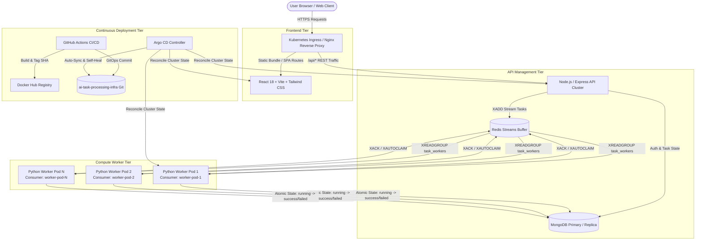

# AI Task Processing Platform — System Architecture & Engineering Whitepaper

An enterprise-grade, asynchronous, distributed text processing platform built on Node.js, Express, Redis Streams, Python 3.12, MongoDB, React, Docker, Kubernetes, and Argo CD GitOps.

---

## 1. System Architecture Overview

The **AI Task Processing Platform** is engineered to separate request orchestration from computational processing. In traditional monolithic architectures, long-running text or data processing within the HTTP request-response lifecycle creates thread blocking, resource starvation, timeouts, and poor user experience. 

This platform eliminates those constraints through an asynchronous, distributed event-driven architecture.



### Component Breakdown

1. **Frontend Tier (React + Vite + Tailwind CSS)**:
   - Single Page Application (SPA) offering an enterprise dashboard with KPI metrics, status distribution, task history, and interactive inspection console.
   - Real-time task tracking using an adaptive polling hook (`useTaskPolling`) that checks execution status every 1.5s while in `pending` or `running` state, then gracefully halts upon terminal status (`success` or `failed`).
   - Secure token storage supporting both Bearer Authorization headers and HttpOnly cookies.

2. **Backend API Tier (Node.js + Express + Mongoose + ioredis)**:
   - Stateless REST microservices secured with JWT authentication, bcryptjs (salt factor 10), Helmet HTTP headers, and rate limiting.
   - Enforces strict input validation via Zod schemas and validates user ownership on all task resources.
   - Publishes jobs to Redis Streams (`XADD tasks:stream * ...`) and saves metadata to MongoDB with initial status `pending`.

3. **Message Queue Tier (Redis Streams)**:
   - Employs Redis Streams with consumer groups (`task_workers`) rather than pub/sub or simple lists.
   - Ensures persistent buffering, parallel consumer delivery, explicit acknowledgments (`XACK`), and stalled message reclamation (`XAUTOCLAIM`).

4. **Compute Worker Tier (Python 3.12 + redis-py + PyMongo)**:
   - Dedicated background workers operating independently from the web layer.
   - Atomic state transitions: updates MongoDB to `running` with `startedAt`, executes the deterministic algorithm, captures performance metrics, and updates final status to `success` or `failed` with detailed structured logs.

5. **Data Persistence Tier (MongoDB 7.0)**:
   - Scalable document store holding user credentials and task lifecycle telemetry.
   - Compound and sparse indexing designed for query throughput.

6. **GitOps & Delivery Tier (GitHub Actions + Argo CD)**:
   - Multi-stage Docker builds push immutable commit-tagged images to container registry.
   - Argo CD continuously reconciles desired GitOps repository state with the live Kubernetes cluster (`ai-task-platform` namespace).

---

## 2. Worker Scaling Strategy & Distributed Queueing

### Why Redis Streams Over Ephemeral Pub/Sub or Lists?

| Feature | Redis Pub/Sub | Redis Lists (`BLPOP`) | Redis Streams (`XREADGROUP`) |
| :--- | :--- | :--- | :--- |
| **Delivery Model** | Fire-and-forget (ephemeral) | Competing consumers | Consumer Group fan-out |
| **Message Persistence** | None (lost if consumer offline) | Memory until popped | Durable log in RAM + AOF on disk |
| **Acknowledgment** | Not supported | Not supported (lost on crash) | Explicit `XACK` required |
| **Crash Recovery** | Zero recovery | Manual retry queue required | Built-in Pending Entries List (PEL) |
| **Parallel Scaling** | All receive same copy | Single worker pops | Distributed across group replicas |

### Redis Streams Consumer Group Mechanics

1. **Consumer Group Partitioning**:
   - The queue operates under stream `tasks:stream` with consumer group `task_workers`.
   - Each worker pod identifies itself with a unique consumer name: `worker-$(POD_NAME)`.
   - Using `XREADGROUP GROUP task_workers worker-<id> BLOCK 2000 COUNT 1 STREAMS tasks:stream >`:
     - The special ID `>` guarantees that the message has **never been delivered to any other worker** in the group.
     - Race conditions and duplicate executions are mathematically prevented by Redis's single-threaded event loop.

2. **Pending Entries List (PEL) & Acknowledgment (`XACK`)**:
   - Once a message is delivered to a worker, Redis places it in the group's Pending Entries List (PEL).
   - The message remains in the PEL until the worker successfully writes results to MongoDB and issues `XACK tasks:stream task_workers <message_id>`.

3. **Orphaned Job Recovery (`XAUTOCLAIM`)**:
   - If a worker pod crashes (OOMKill, node eviction, network partition) while executing a task, the message remains unacknowledged in the PEL.
   - Surviving worker replicas run an automated background check every 15 seconds:
     ```
     XAUTOCLAIM tasks:stream task_workers <worker_id> 30000 0-0 COUNT 5
     ```
   - Any message idle in the PEL for longer than 30 seconds (`CLAIM_MIN_IDLE_TIME_MS`) is reclaimed by a live worker and executed, ensuring **no job is ever permanently stuck in `pending` or `running`**.

4. **Horizontal Scaling**:
   - Compute capacity scales linearly by increasing worker replicas in Kubernetes:
     ```bash
     kubectl scale deployment worker --replicas=5 -n ai-task-platform
     ```
   - Each new worker pod registers as a new consumer in `task_workers` and starts pulling from the shared stream without configuration changes.

---

## 3. High-Throughput Analysis: 100,000 Tasks Per Day

### Baseline Calculations
- **Total tasks per day**: $100,000\text{ tasks}$
- **Seconds in a day**: $86,400\text{ seconds}$
- **Average Throughput**:
  $$\text{Throughput}_{\text{avg}} = \frac{100,000}{86,400} \approx 1.16\text{ tasks/second}$$
- **Peak Hour Distribution**:
  In typical SaaS workloads, 70% of daily traffic arrives within an 8-hour window (10:00 AM – 6:00 PM):
  $$\text{Throughput}_{\text{peak}} = \frac{70,000\text{ tasks}}{8 \times 3,600\text{ seconds}} \approx 2.43\text{ tasks/second}$$
  With peak spikes reaching **10x baseline** ($\approx 12\text{ to } 25\text{ tasks/second}$).

### Resource & Sizing Analysis

1. **Worker Compute Capacity**:
   - Benchmarked Python string processing durations:
     - `UPPERCASE`: $\approx 2.5\text{ ms}$
     - `LOWERCASE`: $\approx 2.5\text{ ms}$
     - `REVERSE_STRING`: $\approx 3.0\text{ ms}$
     - `WORD_COUNT`: $\approx 4.0\text{ ms}$
   - Including network round-trip to MongoDB and Redis acknowledgment, a single worker process handles $\approx 50\text{ tasks/second}$.
   - **Required Workers**: A minimum of **2 replicas** easily fulfills average ($1.16\text{ tasks/s}$) and peak ($25\text{ tasks/s}$) traffic with $>100\%$ headroom.

2. **Redis Memory & Throughput**:
   - Each task stream entry payload ($\text{taskId}$, $\text{operation}$, $\text{retryCount}$, timestamp) is $\approx 250\text{ bytes}$.
   - Even if the queue buffers 10,000 unprocessed tasks simultaneously, RAM consumption is under **$5\text{ MB}$**.
   - Redis easily handles $>50,000\text{ ops/sec}$ on a single core; $25\text{ ops/sec}$ consumes $<0.1\%$ of Redis capacity.

3. **Database Connection Pooling**:
   - Backend Express API uses Mongoose connection pool: `minPoolSize: 5`, `maxPoolSize: 50`.
   - Worker PyMongo client uses `maxPoolSize: 50`.
   - Write load for 100k tasks/day entails:
     - 1 task document creation (`INSERT`)
     - 1 status update to `running` (`UPDATE`)
     - 1 status update to `success` with logs (`UPDATE`)
     - Total: $300,000\text{ DB writes/day} \approx 3.5\text{ writes/second}$. MongoDB comfortably handles thousands of writes per second on standard SSD storage.

4. **Queue Lag Monitoring & Backpressure**:
   - Queue lag is tracked in real-time via `XLEN tasks:stream` and `XPENDING tasks:stream task_workers`.
   - If `XLEN` exceeds 500 tasks, Kubernetes Horizontal Pod Autoscaler (HPA) triggers automated scale-out of worker pods from 2 to 10 replicas.

---

## 4. Database Indexing Strategy

MongoDB indexes are specifically designed to optimize query patterns across users and worker processes.

| Collection | Index | Index Type | Rationale & Query Pattern |
| :--- | :--- | :--- | :--- |
| `users` | `{ email: 1 }` | **Unique** | Enforces email uniqueness at the database layer; enables $O(1)$ user lookup during login and registration checks. |
| `tasks` | `{ userId: 1, createdAt: -1 }` | **Compound** | Powers the primary Task History query (`GET /api/tasks?page=1`). The equality match on `userId` followed by sort order on `createdAt` eliminates in-memory sorting. |
| `tasks` | `{ status: 1, createdAt: -1 }` | **Compound** | Powers administrative status filtering and operational dashboards tracking active system state. |
| `tasks` | `{ userId: 1, status: 1 }` | **Compound** | Powers the User Stats aggregation (`GET /api/tasks/stats`), computing total, pending, running, success, and failed counts via fast index-only scans. |
| `tasks` | `{ status: 1 }` | **Single Field** | Enables high-speed detection and recovery of stalled tasks without table scans. |

---

## 5. Redis Failure Handling & Resilience

1. **AOF Persistence (`appendonly yes`)**:
   - Redis is configured with Append-Only File (AOF) persistence with `fsync everysec`. In the event of an abrupt Redis container restart, queue state is restored with at most 1 second of data loss exposure.

2. **Reconnection & Retry Backoff**:
   - Backend `ioredis` implements an exponential backoff retry strategy (`Math.min(times * 200, 3000)`) with automatic resubscription.
   - Python worker catches `redis.ConnectionError`, sleeps for 3 seconds, and re-establishes the connection without process termination.

3. **Idempotent Job Processing**:
   - Every job payload contains the immutable MongoDB `taskId`.
   - Before processing, the worker checks if `task.status === "success"`. If the task has already been processed (e.g. Redelivery after network partition), the worker skips re-execution and immediately calls `XACK`.

4. **Atomic State Updates**:
   - Status transitions from `pending` to `running` utilize conditional updates:
     ```python
     collection.update_one({"_id": task_id, "status": "pending"}, {"$set": {"status": "running"}})
     ```
   - Only the first worker to update the record proceeds; duplicates are discarded.

5. **Poison Pill Prevention**:
   - If a task payload is corrupted or contains an unrecoverable processing error, the worker marks the task as `failed`, logs the exact error details into MongoDB, and acknowledges the message (`XACK`) to prevent infinite reprocessing loops.

---

## 6. Staging & Production Deployment via GitOps

The infrastructure repository (`ai-task-processing-infra`) separates environments using Kustomize overlays managed by Argo CD.

```
ai-task-processing-infra/kubernetes/
├── base/                   # Canonical resource blueprints
└── overlays/
    ├── staging/            # Staging: 1 replica, debug log level, staging namespace
    └── production/         # Production: HPA, 4+ replicas, TLS Ingress, strict resources
```

### GitOps Delivery Pipeline

1. **Continuous Integration**:
   - Code pushed to `ai-task-processing-platform` triggers `.github/workflows/ci.yml`.
   - Runs frontend tests (Vitest), backend API tests (Jest/Supertest with MongoDB & Redis services), and worker tests (Flake8 & Pytest).

2. **Automated Container Packaging**:
   - `.github/workflows/build-and-push.yml` builds multi-stage Docker images.
   - Images are tagged with the short Git commit SHA (e.g., `aitaskplatform/backend:a1f14d0`).

3. **Infrastructure Manifest Update**:
   - CI workflow clones `ai-task-processing-infra`.
   - Updates `newTag` in `kubernetes/overlays/staging/kustomization.yaml` and commits the change.

4. **Argo CD Auto-Reconciliation**:
   - Argo CD detects Git change in `ai-task-processing-infra`.
   - Applies the updated image tag to the cluster automatically with zero downtime rolling updates.

5. **Production Release Gate**:
   - Production deployment targets `kubernetes/overlays/production/kustomization.yaml`.
   - Guarded by GitHub Actions environment approval gate requiring manual sign-off before manifests update.

6. **Instant Rollback**:
   - Reverting the Git commit in the infrastructure repository triggers Argo CD to immediately revert pods to the previous image tag.

---

## 7. Security Architecture

1. **Authentication & Password Protection**:
   - Passwords hashed using `bcryptjs` with salt rounds = 10.
   - Password hash excluded from query selections (`select: false`) and sanitized in Mongoose `toJSON()`.
   - JWT tokens signed with SHA-256 HMAC using 32+ character secrets. Tokens expire in 7 days.
   - Supports both `Authorization: Bearer <token>` and `HttpOnly`, `SameSite=Strict`, `Secure` cookies.

2. **Authorization & Resource Ownership**:
   - All task endpoints (`/api/tasks/*`) require authentication middleware.
   - Every database query scopes to `userId: req.user._id`, preventing unauthorized access or horizontal privilege escalation.

3. **Network & Container Security**:
   - Docker containers run as non-root users (`node` in backend, `workeruser:10001` in worker, `nginx` in frontend).
   - Multi-stage builds prevent compiler tools, test files, and package caches from reaching production images.
   - MongoDB and Redis are not exposed to external ingress and remain accessible only via internal Kubernetes ClusterIP services.
   - Kubernetes Secrets inject sensitive values; secrets are ignored from Git via `.gitignore`.
   - API rate limiting prevents brute-force authentication attempts (30 requests / 15 minutes on auth endpoints).
