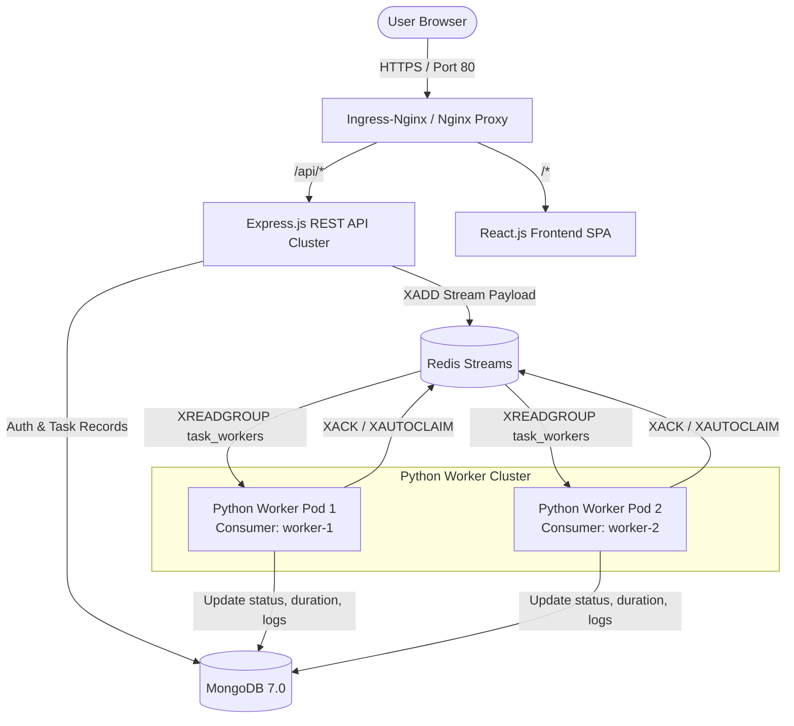

# AI Task Processing Platform

A production-grade, distributed text-processing platform built on the MERN stack with an asynchronous Python 3.12 worker engine, Redis Streams consumer groups, Docker orchestration, and Kubernetes GitOps delivery with Argo CD.

---

## 1. Project Overview

The **AI Task Processing Platform** allows authenticated users to submit compute-intensive text transformation jobs and execute them asynchronously. 

Rather than running blocking transformations directly within the HTTP request lifecycle, the Express backend queues the task into **Redis Streams**. A distributed cluster of **Python workers** continuously consumes jobs, updates real-time telemetry and execution logs in **MongoDB**, and signals job completion with explicit acknowledgments (`XACK`). Users observe their task progression live on a modern React dashboard without manual page refreshes.

---

## 2. Key Features

- **Asynchronous Task Processing**: Web requests never block on compute operations. Tasks are buffered and distributed via Redis Streams.
- **Enterprise Authentication**: User registration and login using bcryptjs password hashing (salt 10), JWT access tokens, HttpOnly secure cookies, and route guards.
- **Four Text Operations**:
  1. `UPPERCASE`: Capitalize entire text.
  2. `LOWERCASE`: Lowercase entire text.
  3. `REVERSE STRING`: Full character reversal preserving symbols and whitespace.
  4. `WORD COUNT`: Fast whitespace token counting.
- **Resilient Distributed Queue**:
  - Redis Streams consumer groups (`task_workers`).
  - Strict job acknowledgment (`XACK`).
  - Automatic reclamation of stalled tasks from dead worker pods (`XAUTOCLAIM`).
  - Task retry mechanism with exponential attempt tracking.
- **Live Status Telemetry**: Adaptive real-time polling updates task status (`pending` -> `running` -> `success` / `failed`) and streams execution logs.
- **Observability & Audit Logs**: Worker performance metrics, execution duration in milliseconds, worker ID tracking, and timestamped console events.
- **Multi-Stage Containerization**: Minimal, hardened Docker images running under non-root users (`node`, `workeruser:10001`, `nginx`).
- **GitOps & Kubernetes Ready**: Declarative K8s manifests, Kustomize overlays (`staging` and `production`), Ingress routing, and automated reconciliation via Argo CD.

---

## 3. Technology Stack

| Layer | Technologies |
| :--- | :--- |
| **Frontend** | React 18, Vite, Tailwind CSS, Axios, React Router v6, Lucide React, React Hot Toast |
| **Backend API** | Node.js, Express.js, MongoDB, Mongoose, JWT, bcryptjs, Helmet, Express Rate Limit, Zod |
| **Worker Engine** | Python 3.12+, redis-py, PyMongo, Pydantic Settings, Structured JSON Logging |
| **Infrastructure** | Redis 7, MongoDB 7, Docker, Docker Compose, Kubernetes (k3s), Ingress-Nginx |
| **GitOps & CI/CD** | Argo CD (Auto-sync, Self-heal, Prune), GitHub Actions, Kustomize |

---

## 4. System Architecture



---

## 5. Repository Structure

```
AI Task Processing Platform/
│
├── ai-task-processing-platform/        # [Repository 1] Application Source Code
│   ├── frontend/                       # React 18 + Vite + Tailwind SPA
│   │   ├── src/
│   │   │   ├── components/             # Reusable UI components (StatusBadge, Navbar, Modal)
│   │   │   ├── pages/                  # Landing, Auth, Dashboard, History, Details
│   │   │   ├── context/                # AuthContext (JWT session management)
│   │   │   ├── hooks/                  # useTaskPolling hook
│   │   │   ├── services/               # Axios API client
│   │   │   └── App.jsx
│   │   ├── Dockerfile                  # Multi-stage: Node builder -> Nginx Alpine
│   │   ├── nginx.conf
│   │   └── package.json
│   │
│   ├── backend/                        # Node.js Express REST API
│   │   ├── src/
│   │   │   ├── config/                 # DB, Redis, and Zod Environment configs
│   │   │   ├── controllers/            # Auth, Task, and Health controllers
│   │   │   ├── middleware/             # Auth, RateLimiter, Validation, Error middlewares
│   │   │   ├── models/                 # User and Task Mongoose schemas & compound indexes
│   │   │   ├── routes/                 # Express API routes
│   │   │   ├── services/               # Business logic & Redis Stream Queue service
│   │   │   ├── validators/             # Zod input schemas
│   │   │   ├── utils/                  # Winston logger and standardized responses
│   │   │   ├── app.js
│   │   │   └── server.js
│   │   ├── Dockerfile                  # Multi-stage Node 20 Alpine, non-root user
│   │   └── package.json
│   │
│   ├── worker/                         # Python 3.12 Asynchronous Worker Engine
│   │   ├── app/
│   │   │   ├── config/                 # Pydantic Settings
│   │   │   ├── database/               # PyMongo client
│   │   │   ├── processors/             # Text operations (uppercase, reverse, word count)
│   │   │   ├── queue/                  # Redis Streams Consumer with XAUTOCLAIM recovery
│   │   │   ├── services/               # Task lifecycle and MongoDB persistence
│   │   │   ├── utils/                  # Structured JSON logger
│   │   │   └── main.py
│   │   ├── Dockerfile                  # Multi-stage Python 3.12-slim, non-root user
│   │   └── requirements.txt
│   │
│   ├── docker-compose.yml              # 5-service orchestration with health checks
│   ├── .env.example
│   ├── ARCHITECTURE.md                 # In-depth architectural design whitepaper
│   └── .github/workflows/
│       ├── ci.yml                      # CI test pipeline (Frontend, Backend, Worker)
│       └── build-and-push.yml          # Container build & GitOps manifest update
│
└── ai-task-processing-infra/           # [Repository 2] Infrastructure & GitOps
    ├── kubernetes/
    │   ├── base/                       # Namespace, ConfigMap, Secrets, Services, Deployments
    │   └── overlays/                   # Staging and Production Kustomize overlays (HPA)
    ├── argocd/                         # Declarative Argo CD Applications (Auto-sync)
    └── scripts/                        # Setup, deployment, and worker scaling scripts
```

---

## 6. Prerequisites

Ensure you have the following installed locally:
- **Node.js**: v20.x or higher
- **Python**: 3.12 or higher
- **Docker & Docker Compose**: v24+ / Compose v2.20+
- **Git**
- Optional: **k3s / minikube** for Kubernetes deployments

---

## 7. Environment Variable Setup

Copy the template configuration:

```bash
cd ai-task-processing-platform
cp .env.example .env
```

Configuration reference:

```env
# Application Ports
PORT=5000
CLIENT_URL=http://localhost:5173

# Database & Cache
MONGODB_URI=mongodb://localhost:27017/ai_task_platform
REDIS_HOST=localhost
REDIS_PORT=6379
REDIS_PASSWORD=

# Authentication
JWT_SECRET=super_secret_jwt_key_at_least_32_characters_long_for_security
JWT_EXPIRES_IN=7d

# Queue & Logging
STREAM_KEY=tasks:stream
CONSUMER_GROUP=task_workers
LOG_LEVEL=INFO
```

---

## 8. Local Development Setup (Running Directly)

### Step 1: Start MongoDB & Redis
If you have local Docker running:
```bash
docker run -d -p 27017:27017 --name local-mongo mongo:7.0
docker run -d -p 6379:6379 --name local-redis redis:7-alpine
```

### Step 2: Start Backend API
```bash
cd backend
npm install
npm run dev
```
Backend API will start on: **http://localhost:5000**

### Step 3: Start Python Background Worker
```bash
cd worker
python3 -m venv .venv
source .venv/bin/activate
pip install -r requirements.txt
python -m app.main
```
Worker starts consuming from Redis Stream `tasks:stream`.

### Step 4: Start React Frontend
```bash
cd frontend
npm install
npm run dev
```
Access the web dashboard at: **http://localhost:5173**

---

## 9. Docker Compose Setup (One-Click Production Run)

Orchestrate the entire platform (Frontend, Backend, Worker, MongoDB, Redis) with health checks:

```bash
cd ai-task-processing-platform

# 1. Build all production multi-stage images
docker compose build

# 2. Launch all services in background
docker compose up -d

# 3. Check health status of all containers
docker compose ps

# 4. View unified streaming logs
docker compose logs -f

# 5. Stop all services and persist data
docker compose down
```

Service URLs:
- **Web Dashboard**: http://localhost
- **Backend API**: http://localhost:5000
- **API Health Check**: http://localhost:5000/api/health
- **Readiness Probe**: http://localhost:5000/api/ready

---

## 10. API Specification

### Authentication Routes
| Method | Endpoint | Description | Auth Required |
| :--- | :--- | :--- | :--- |
| `POST` | `/api/auth/register` | Register new user account | No |
| `POST` | `/api/auth/login` | Authenticate user & return JWT | No |
| `POST` | `/api/auth/logout` | Clear token cookie | No |
| `GET` | `/api/auth/me` | Fetch authenticated user profile | Yes |

### Task Management Routes
| Method | Endpoint | Description | Auth Required |
| :--- | :--- | :--- | :--- |
| `POST` | `/api/tasks` | Create and enqueue a new task | Yes |
| `GET` | `/api/tasks` | List paginated tasks (with search & filters) | Yes |
| `GET` | `/api/tasks/:id` | Fetch task details and result | Yes |
| `GET` | `/api/tasks/:id/logs` | Fetch detailed task execution logs | Yes |
| `GET` | `/api/tasks/stats` | Aggregated user metrics | Yes |
| `POST` | `/api/tasks/:id/retry` | Re-enqueue a failed task | Yes |

### System Health Routes
| Method | Endpoint | Description |
| :--- | :--- | :--- |
| `GET` | `/api/health` | Liveness probe (uptime & status) |
| `GET` | `/api/ready` | Readiness probe (verifies MongoDB & Redis connections) |

---

## 11. Automated Testing

### Run Backend Unit & Integration Tests (Jest & Supertest)
```bash
cd backend
npm test
```
Tests cover: user registration, duplicate emails, password validation, JWT authentication, task creation, Redis Streams enqueueing, ownership isolation, pagination, and health probes.

### Run Worker Tests (Pytest)
```bash
cd worker
PYTHONPATH=. .venv/bin/pytest -v
```
Tests cover: all four text operations (`UPPERCASE`, `LOWERCASE`, `REVERSE_STRING`, `WORD_COUNT`), invalid operations, null input handling, consumer group message handling, and idempotent skips.

### Run Frontend Component Tests (Vitest)
```bash
cd frontend
npm test
```

---

## 12. Kubernetes & Argo CD GitOps Deployment

For full deployment documentation and manifests, see [ai-task-processing-infra](file:///home/sama/AI%20Task%20Processing%20Platform/ai-task-processing-infra/README.md).

Quick Deploy Commands:
```bash
cd ../ai-task-processing-infra

# 1. Setup k3s cluster (if needed)
./scripts/setup-k3s.sh

# 2. Deploy Argo CD
./scripts/install-argocd.sh

# 3. Apply GitOps Applications
kubectl apply -f argocd/staging-application.yaml
kubectl apply -f argocd/production-application.yaml

# 4. Scale workers horizontally
./scripts/test-scaling.sh ai-task-platform 4
```

---

## 13. Troubleshooting

- **MongoDB connection refused**:
  Verify MongoDB container or service is running: `docker compose ps mongodb` or `systemctl status mongod`.
- **Redis connection errors**:
  Ensure Redis is accessible on port 6379: `docker exec -it ai_task_redis redis-cli ping`.
- **Tasks remaining in pending**:
  Confirm at least one Python worker pod is active: `docker compose logs -f worker`. Inspect Redis stream messages via `docker exec -it ai_task_redis redis-cli XINFO STREAM tasks:stream`.
